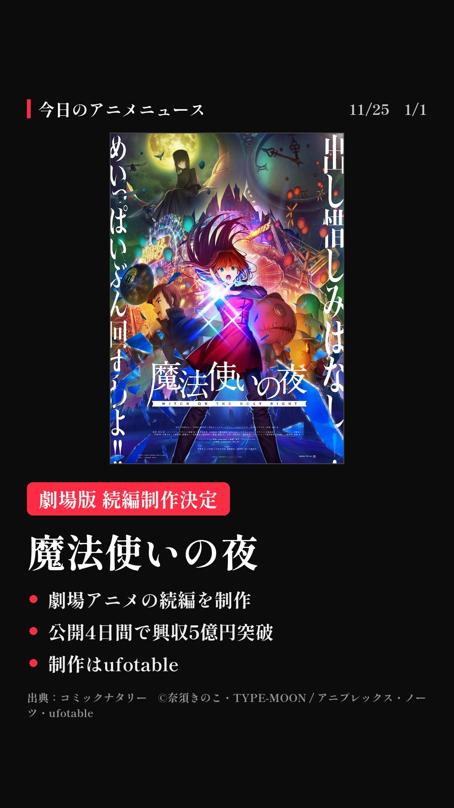
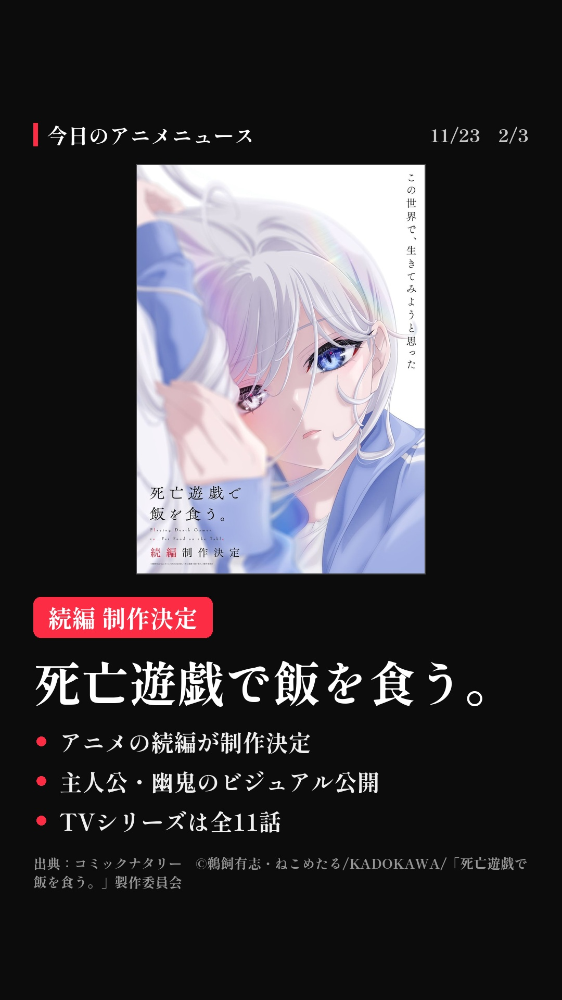
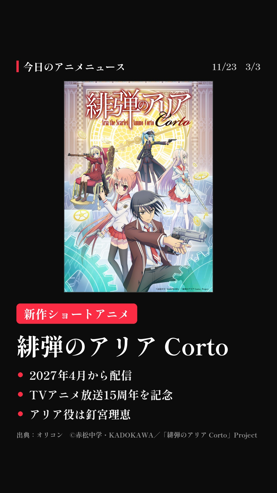

# 今日のアニメニュース

Threadsへの自動投稿: **している**

## 2026-11-26

### ストーリー画像（長押しで保存）


<details><summary>Threadsの投稿 8本</summary>

**07:30 25時、赤坂で**

```
25時、赤坂で、アニメ化きた。ドラマCDのお二人がそのまま続投なのが嬉しい。

【TVアニメ化決定】25時、赤坂で
・2027年にTBSで放送開始
・白崎役は斉藤壮馬
・羽山役は佐藤拓也

キャストはドラマCDから続投。原作は夏野寛子さんのBLマンガで、シリーズ累計200万部を突破している。ティザービジュアルとティザーPVも公開された。

原作もドラマも見てる人、アニメで一番見たい場面どこ？
```

**12:15 幼稚園WARS**

```
幼稚園WARS、放送が2027年4月に決まったうえにOPがAdo。これは気になる。

【2027年4月放送】幼稚園WARS
・2027年4月にテレ東系6局ネット
・OPはAdo「ビバヤタラメッタ」
・リタ役は種﨑敦美

制作はサンライズとFelixFilm、監督は五味伸介。メインビジュアルと第1弾PVも公開された。

原作読んでる人、アニメで一番見たいキャラは誰？
```

**12:30 話しかけ**

```
好きなアニメの原作、先に読んじゃう派？
それともアニメを見終わってから読む派？
```

**18:00 姫騎士様のヒモ**

```
姫騎士様のヒモ、メインPVの第2弾が出た。1月3日からだから、もうすぐ。

【新キャスト・PV第2弾】姫騎士様のヒモ
・2027年1月3日から放送開始
・新キャストに広瀬裕也ほか
・EDはsajou no hana「偽花」

新キャストは広瀬裕也、石見舞菜香、若山詩音、大西沙織。メインPV第2弾でEDが流れる。

冬アニメ、もう見る予定の作品ある？
```

**19:00 ヒストリエ**

```
ヒストリエ、1月8日スタートで初回は2話連続。ヨルシカのOPも気になる。

【1月8日放送開始】ヒストリエ
・2027年1月8日からアニメイズム
・初回は2話連続放送
・OPはヨルシカ「真っ白」

ナレーションは森山未來。Prime Videoでの最速配信も決定。EDはレトロリロン「アンフィリア」。12月24日には第1話から第3話の先行上映会がある。

原作を読んでる人、アニメで見たい場面はある？
```

**21:00 渡り鳥とカタツムリ**

```
渡り鳥とカタツムリ、アニメが2027年夏と決まったみたい。のんびりしたクルマ旅が動くの楽しみ。

【2027年夏放送】渡り鳥とカタツムリ
・TVアニメは2027年夏に放送
・原作は高津マコトさん
・最新7巻が11月25日発売

雲平とつぐみが車で寝泊まりしながら旅するロードコミック。7巻では熊本・阿蘇の音楽フェスを目指す。

車で行ってみたい旅先ってある？
```

**21:30 話しかけ**

```
子どものころ毎週欠かさず見てたアニメって何だった？
今でも主題歌を歌えるやつ
```

**22:30 まとめ**

```
【11/26 のアニメニュースまとめ】

・25時、赤坂で：TVアニメ化決定
・幼稚園WARS：2027年4月放送
・ヒストリエ：1月8日放送開始
・渡り鳥とカタツムリ：2027年夏放送
・姫騎士様のヒモ：新キャスト・PV第2弾

気になるニュースはありましたか？
```

</details>

## 2026-11-25

### ストーリー画像（長押しで保存）



<details><summary>Threadsの投稿 8本</summary>

** 魔法使いの夜**

```
魔法使いの夜、続編も決まったんだ。ufotableの映像でまた青子たちに会えるの嬉しい。

【劇場版 続編制作決定】魔法使いの夜
・劇場アニメの続編を制作
・公開4日間で興収5億円突破
・制作はufotable

11月20日公開の第1作は、公開4日間で観客動員30万1630人。続編の公開時期などの詳細は今後発表される見通し。

もう映画見た人、一番印象に残ったシーンどこだった？
```

** 超かぐや姫！ほか日本7作品**

```
超かぐや姫！がアカデミー賞の審査対象に入ったって。日本から7作品もあるの、ちょっとワクワクする。

【米アカデミー賞の対象に】超かぐや姫！ほか日本7作品
・アカデミー賞長編アニメ対象38本
・日本からは7作品が対象

日本作品は「ALL YOU NEED IS KILL」「超かぐや姫！」「GROTESQQQUE -グロテスク-」「無名の人生」「ホウセンカ」「閃光のハサウェイ キルケーの魔女」「THE RIBBON HERO リボンヒーロー」。ノミネートは2027年1月21日に発表。

この7作品、もう見たのある？
```

** あかね噺 第2期**

```
あかね噺の2期、ABEMAで最速無料なのありがたい。落語の熱さがまた見られるの楽しみ。

【ABEMAで最速無料】あかね噺 第2期
・2027年1月9日から配信
・毎週土曜24時に最新話
・クール中は全話無料

2027年1月からの第2期放送開始予定。1期は2026年4月放送。

1期で一番心に残った高座どれだった？
```

** ペンと手錠と事実婚**

```
ペンと手錠と事実婚、40歳の刑事と筆談女子高生の組み合わせが気になる。OPは水瀬いのりさんなのも楽しみ。

【放送日・追加キャスト】ペンと手錠と事実婚
・2027年1月9日深夜1時から
・TOKYO MX・BS11で放送
・追加は小林裕介ら3人

追加キャストは小林裕介、諸星すみれ、雨宮天。OPは水瀬いのり、EDはsaecoが担当。

来期、この作品見る予定ある？
```

** ツイステエピソード オブ サバナクロー**

```
ツイステのサバナクロー編、配信まで1か月切ったんだね。レオナの表情がもう気になる。

【ペイオフPV公開】ツイステエピソード オブ サバナクロー
・12月23日からDisney+で配信
・EDは「DIADEM」に決定

ペイオフPVと最新場面カットが公開された。

ツイステ、一番推してる寮どこ？
```

** まとめ**

```
【11/25 のアニメニュースまとめ】

・魔法使いの夜：劇場版 続編制作決定
・超かぐや姫！ほか日本7作品：米アカデミー賞の対象に
・あかね噺 第2期：ABEMAで最速無料
・ペンと手錠と事実婚：放送日・追加キャスト
・ツイステエピソード オブ サバナクロー：ペイオフPV公開

気になるニュースはありましたか？
```

** 話しかけ**

```
渋いテーマなのに、気づいたらハマってたアニメってある？
あったら教えてほしい
```

** 話しかけ**

```
映画館で見たアニメで、いちばん記憶に残ってる作品は？
```

</details>

## 2026-11-24

ストーリー画像: 新作・続編のニュースが無かったので、作っていません

<details><summary>Threadsの投稿 6本</summary>

** 結界師の一輪華**

```
結界師の一輪華、OPはなにわ男子の「一輪華」なんだ。和風の世界観に合う曲になりそうで気になる。

【OPはなにわ男子】結界師の一輪華
・2027年1月6日放送・配信開始
・OP主題歌はなにわ男子「一輪華」
・初回は1時間スペシャル

TOKYO MXほか、Netflixで放送・配信。メインビジュアルとメインPVも公開された。12月27日には第1話1時間スペシャルの劇場先行上映イベントを開催する。

アニメの主題歌でアイドルが歌うの、あり？なし？
```

** 雑用付与術師が自分の最強に気付くまで**

```
雑用付与術師、追加キャスト3人きた。放送が1月4日なのでもうすぐなんだよね。

【追加キャスト発表】雑用付与術師が自分の最強に気付くまで
・ニクラ役は広瀬ゆうき
・メーリス役は高森奈津美
・ソフィーア役は貫井柚佳

2027年1月4日放送開始。3人のコメントも公開された。

冬アニメ、もう見る予定の作品決めてる？
```

** 地元のいじめっ子達に仕返ししようとしたら、別の戦いが始まった。**

```
いじはじ、シグレ役はLynnさんなんだ。毎日キャストが出てくるの、ちょっと楽しみになってる。

【メインキャスト発表】地元のいじめっ子達に仕返ししようとしたら、別の戦いが始まった。
・満月シグレ役はLynn
・2027年に放送開始

メインキャストは4日連続で発表されていて、三日月アキラ役は前田佳織里、朧月カナエ役は夏吉ゆうこ。

ラブコメアニメで推せるヒロインのタイプってどんな子？
```

** まとめ**

```
【11/24 のアニメニュースまとめ】

・結界師の一輪華：OPはなにわ男子
・雑用付与術師が自分の最強に気付くまで：追加キャスト発表
・地元のいじめっ子達に仕返ししようとしたら、別の戦いが始まった。：メインキャスト発表

気になるニュースはありましたか？
```

** 話しかけ**

```
最終回でちゃんと泣けるアニメ教えてほしい
完結してるやつだと嬉しい
```

** 話しかけ**

```
アニメのオープニング、毎回飛ばさず見る派？
それとも1話目だけ見る派？
```

</details>

## 2026-11-23

### ストーリー画像（長押しで保存）





<details><summary>Threadsの投稿 9本</summary>

** その者。のちに…**

```
その者。のちに…、アニメ化きた。ワズ役の伊東健人さんが主題歌も歌うの、ちょっと気になる。

【TVアニメ化決定】その者。のちに…
・2027年に放送
・ワズ役は伊東健人
・メアル役は小倉唯

アニメーション制作は寿門堂。伊東健人はオープニング主題歌も担当する。原作は「小説家になろう」発の小説。

原作やコミカライズ読んでる人、アニメで一番見たい場面どこ？
```

** 死亡遊戯で飯を食う。**

```
死亡遊戯で飯を食う。、続編決まった。幽鬼のビジュアルが静かで、続きがもう気になる。

【続編 制作決定】死亡遊戯で飯を食う。
・アニメの続編が制作決定
・主人公・幽鬼のビジュアル公開
・TVシリーズは全11話

TVシリーズは2026年1月から放送。7月には劇場版「44:CLOUDY BEACH」の2週間限定上映があった。続編の情報は公式サイトと公式SNSで順次発表。

続編で見たいエピソードある？
```

** 緋弾のアリア Corto**

```
緋弾のアリアの新作、ショートアニメでくるの嬉しい。15周年ってもうそんなたつんだ。

【新作ショートアニメ】緋弾のアリア Corto
・2027年4月から配信
・TVアニメ放送15周年を記念
・アリア役は釘宮理恵

キンジ役は間島淳司。リサ・メヌエット・ネモが初登場する。監督は笹原嘉文、制作はベルノックスフィルムズ。

アリアで一番好きなキャラって誰？
```

** ようこそ実力至上主義の教室へ**

```
よう実の5期、来年なんだ。2部構成なのはじっくり見られそうで嬉しい。

【5期は2027年放送】ようこそ実力至上主義の教室へ
・第5期は2027年に放送
・2年生編2学期は前半・後半の2部構成
・ティザービジュアル公開

今回放送が決まったのは「5th Season 2年生編2学期＜前半＞」。原作はシリーズ累計840万部を突破している。

放送までに4期見返す人いる？
```

** 鬼滅の刃 無限列車編**

```
鬼滅の再放送、無限列車編が最終回だったんだ。煉獄さんの場面は何回見ても泣く。

【再放送が最終回】鬼滅の刃 無限列車編
・11/22に第七話を放送
・無限列車編の最終回
・煉獄の戦いに反応が集まる

第七話は「心を燃やせ」。視聴者から「朝から号泣確定」などの声が出た。

鬼滅で一番好きな場面どこ？
```

** 尚善**

```
尚善の新PV、戦闘シーンも入ってて気になる。花澤香菜さんの顧九歌も楽しみ。

【新PV・追加キャスト】尚善
・第2弾PVとキービジュアル公開
・顧九歌役に花澤香菜
・2027年4月放送開始

2027年2月6日に東京で先行上映＆トークイベントが開催される。

中華ファンタジーのアニメ、好きな作品ある？
```

** まとめ**

```
【11/23 のアニメニュースまとめ】

・その者。のちに…：TVアニメ化決定
・死亡遊戯で飯を食う。：続編 制作決定
・緋弾のアリア Corto：新作ショートアニメ
・ようこそ実力至上主義の教室へ：5期は2027年放送
・鬼滅の刃 無限列車編：再放送が最終回
・尚善：新PV・追加キャスト

気になるニュースはありましたか？
```

** 話しかけ**

```
続きが気になりすぎて一気見しちゃったアニメ、何だった？
完結してるやつだと嬉しい
```

** 話しかけ**

```
アニメの再放送で、つい最後まで見ちゃったことある？
どの作品だった？
```

</details>

## 2026-11-22

ストーリー画像: 新作・続編のニュースが無かったので、作っていません

<details><summary>Threadsの投稿 7本</summary>

** 多聞くん今どっち!?**

```
多聞くん今どっち!?、2期きた。推し活ラブコメの続きが見られるの嬉しい。

【第2期 製作決定】多聞くん今どっち!?
・F/ACEのライブで発表
・第1期は今年1月放送
・原作は師走ゆき

11月21日開催のライブイベント「F/ACE FIRST LIVE “NAUTICAL STAR”」での告知。推しのアイドルの家を担当する家事代行バイトの高校生を描くラブコメ。

1期で一番ときめいた場面どこ？
```

** アオハル・ワンスモア**

```
アオハル・ワンスモア、1月から放送って決まったね。ドラマCDからキャストが続投なのも安心する。

【2027年1月放送】アオハル・ワンスモア
・2027年1月からテレ東
・隼人は海渡翼、律は浦和希
・12/22に先行上映イベント

原作は宮田トヲルのボーイズラブ漫画。原作漫画の絵素材をベースに動きや声、音楽を加えるライトアニメ。PV第1弾も公開された。

ライトアニメって見たことある？
```

** 薬屋のひとりごと**

```
薬屋のひとりごと、56話の猫猫と壬氏の街歩きでSNSがかなり盛り上がってたみたい。

【第56話が反響】薬屋のひとりごと
・第56話は11月20日放送
・猫猫と壬氏の街歩きが話題
・阿多妃の過去にも反応

2026年10月から第3期を放送中。第56話のタイトルは「麻と民間信仰」。

この2人の場面、今まででどれが一番好き？
```

** 転生した大聖女は、聖女であることをひた隠す**

```
大聖女、9話から新しい章に入るんだね。新キャラも描かれたビジュアルが気になる。

【KV第2弾公開】転生した大聖女は、聖女であることをひた隠す
・11月28日の第9話から
・新章「サザランド編」に突入
・制作はFelixFilm

TOKYO MXとBS11では毎週土曜22時から放送中。

今のところ推しキャラは誰？
```

** まとめ**

```
【11/22 のアニメニュースまとめ】

・多聞くん今どっち!?：第2期 製作決定
・アオハル・ワンスモア：2027年1月放送
・薬屋のひとりごと：第56話が反響
・転生した大聖女は、聖女であることをひた隠す：KV第2弾公開

気になるニュースはありましたか？
```

** 話しかけ**

```
見終わったあと、しばらく何も手につかなくなったアニメってある？
あったら教えてほしい
```

** 話しかけ**

```
週末のアニメ、一気見する派？
それとも1日1話ずつ味わう派？
```

</details>

## 2026-11-21

### ストーリー画像（長押しで保存）


<details><summary>Threadsの投稿 10本</summary>

** いじはじ**

```
いじはじ、アニメ化きた。勘違いバトルラブコメがどう動くのか気になる。

【TVアニメ化決定】いじはじ
・2027年にTVアニメ化
・監督は熊野千尋
・制作は月虹

正式な題は「地元のいじめっ子達に仕返ししようとしたら、別の戦いが始まった。」。原作はマツモトケンゴ。単行本は講談社より9巻まで刊行。公式Xでは11月21日から毎日12時にメインキャスト4人を発表し、11月24日12時にPVが解禁される。

原作読んでる人、アニメで一番見たい場面どこ？
```

** 欠けた月のメルセデス**

```
欠けた月のメルセデス、日曜の夕方に見られるのいいな。ダンジョン攻略ものはつい見ちゃう。

【放送情報が公開】欠けた月のメルセデス
・2027年1月10日スタート
・TBS系28局 日曜16時半
・追加キャストに大森日雅ら

現代日本の会社員から貧乏貴族の吸血鬼に転生した少女が、探索者としてダンジョンに挑む冒険ファンタジー。マルギット役に大森日雅、モニカ役に富田美憂、ベルンハルト役に速水奨。

ダンジョン攻略系、今まで一番ハマった作品は何？
```

** LiSA「YES」**

```
LiSAさんがグラミー賞にノミネートされてた。アニメの主題歌が世界の賞の候補に入るの、アニメ好きとして嬉しい。

【グラミー賞ノミネート】LiSA「YES」
・第69回グラミー賞にノミネート
・新設のアジアン・ポップ部門
・劇場版魔法科の主題歌

対象曲は劇場版「魔法科高校の劣等生 四葉継承編」の主題歌「YES」。授賞式は2027年2月。日本からはBABYMETALも同部門にノミネート。

LiSAさんの曲で一番好きなのどれ？
```

** ペンと手錠と事実婚**

```
ペンと手錠と事実婚、メインPVが出てた。筆談ヒロインと中年刑事の組み合わせ、気になる。

【追加キャスト・PV公開】ペンと手錠と事実婚
・2027年1月9日25時より放送
・追加キャストに小林裕介ら
・OPは水瀬いのり

賢島渡役に小林裕介、晴山日撫役に諸星すみれ、石室明日香役に雨宮天。EDテーマはsaecoの「メッセージ」。放送はTOKYO MX、BS11。

この組み合わせ、バディものとして好き？
```

** BLEACH FES.**

```
BLEACHの完結記念イベント、ビジュアルが出てた。一護と戦った面々がそろってるの熱い。

【完結記念イベント】BLEACH FES.
・2027年2月27日・28日開催
・会場は幕張メッセ
・キービジュアル公開

完結記念イベントのキービジュアルには一護と戦った13キャラクターが描かれた。11月20日にオリジナルグッズの先行受注販売がスタート。

BLEACHで一番好きな戦いはどれ？
```

** Duel Masters LOST～失楽の訣闘～**

```
デュエマのアニメ、第5章まで来たんだ。ジャシン帝の新しい姿が気になる。

【第5章 制作決定】Duel Masters LOST～失楽の訣闘～
・第5章の制作が決定
・新たなジャシン帝のCG公開

2024年から展開中のシリーズで、第1〜4章がデュエチューブほかで配信中。

子どもの頃、デュエマやってた人いる？
```

** 大みそかだよ！ドラえもん**

```
今年の大みそかのドラえもん、朝8時からなんだ。ひみつ道具メモの初アニメ化は気になる。

【大みそかSP放送】大みそかだよ！ドラえもん
・12月31日 朝8時から1時間
・ひみつ道具メモを初アニメ化

藤子・F・不二雄が書き残したメモを基にしたオリジナルストーリーで、ひみつ道具「出入口チョーク」が登場する。

好きなひみつ道具って何？
```

** まとめ**

```
【11/21 のアニメニュースまとめ】

・いじはじ：TVアニメ化決定
・欠けた月のメルセデス：放送情報が公開
・LiSA「YES」：グラミー賞ノミネート
・ペンと手錠と事実婚：追加キャスト・PV公開
・BLEACH FES.：完結記念イベント
・Duel Masters LOST～失楽の訣闘～：第5章 制作決定
・大みそかだよ！ドラえもん：大みそかSP放送

気になるニュースはありましたか？
```

** 話しかけ**

```
鬱アニメで一番引きずったのって何？
今でも思い出すやつ
```

** 話しかけ**

```
好きなアニメ、原作を先に読む派？
それともアニメから入る派？
```

</details>

## 2026-11-20

ストーリー画像: 新作・続編のニュースが無かったので、作っていません

<details><summary>Threadsの投稿 8本</summary>

** 新 美味しんぼ**

```
新 美味しんぼ、放送が1月4日からって決まったの嬉しい。35年ぶりの完全続編、雄山と山岡の対決をまた見られるのか。

【2027年1月4日放送】新 美味しんぼ
・2027年1月4日からテレビ東京
・山岡と団の恋模様も描かれる
・団一郎役は小野大輔

BS朝日は1月9日から。追加キャストは小野大輔、たくみ靖明、藤田茜、関智一。前作の放送終了から35年ぶりの完全続編。

旧作の究極vs至高、一番印象に残ってる回どれ？
```

** 魔術を極めて旅に出た転生エルフ**

```
転生エルフ、放送日が1月6日に決まってキービジュアルも出てた。追加キャストがけっこう豪華で気になる。

【2027年1月6日放送】魔術を極めて旅に出た転生エルフ
・2027年1月6日からTOKYO MX
・12/30からABEMAで先行配信
・OPはao「ブレス」

追加キャストはラハブ役に照井春佳、グリレット役に檜山修之、ガリウス役に下野紘、シルファ役に緒方恵美。EDはmoon drop「じゃあまた、来世でも」。

冬アニメ、いまのところ何本見る予定？
```

** 冒険者ライセンスを剥奪されたおっさん**

```
冒険者ライセンスを剥奪されたおっさん、1月7日からなのか。おっさんと少女の旅ってほっこりしそうで気になる。

【2027年1月7日放送】冒険者ライセンスを剥奪されたおっさん
・2027年1月7日24時からTOKYO MX
・メインPVとビジュアル公開
・OPは柴田聡子「溺愛」

ダグラス役は安元洋貴、ラビ役は井口裕香。BS12トゥエルビでは1月7日26時から。

冬アニメ、親子っぽい関係の作品って好き？
```

** 魔法使いの夜**

```
魔法使いの夜、今日から劇場公開だ。ufotableの映像が大きなスクリーンで見られるの楽しみ。

【11/20 全国公開】魔法使いの夜
・劇場アニメが11月20日から全国公開
・青子役は戸松遥
・草十郎役は小林裕介

原作はTYPE-MOONのノベルゲーム。制作はufotable。

初日に観に行く人いる？
```

** 魔法騎士レイアース**

```
レイアースの空神ウィンダム、緑川光さんだったのか。緑で風で翼って、たしかに縁ありすぎて笑った。

【ウィンダム役は緑川光】魔法騎士レイアース
・第7話で空神ウィンダム役が判明
・役は緑川光
・SNSで驚きの声が相次いだ

緑川光本人も「この出会いにものすごく運命を感じました（笑）」とコメント。放送は毎週水曜23時45分からテレビ朝日系。

レイアース、旧作から見てた人いる？
```

** まとめ**

```
【11/20 のアニメニュースまとめ】

・新 美味しんぼ：2027年1月4日放送
・魔術を極めて旅に出た転生エルフ：2027年1月6日放送
・冒険者ライセンスを剥奪されたおっさん：2027年1月7日放送
・魔法使いの夜：11/20 全国公開
・魔法騎士レイアース：ウィンダム役は緑川光

気になるニュースはありましたか？
```

** 話しかけ**

```
2周目でも普通に面白いアニメって何？
伏線回収ものだと嬉しい
```

** 話しかけ**

```
人生で最初にハマったアニメ何だった？
今でも主題歌歌えるやつ
```

</details>

## 2026-11-19

ストーリー画像: 新作・続編のニュースが無かったので、作っていません

<details><summary>Threadsの投稿 9本</summary>

** 狼と香辛料MERCHANT MEETS THE WISE WOLF**

```
狼と香辛料の2期、1月に決まったのうれしい。荷馬車を降りて船旅になるの、旅の雰囲気が変わりそうで気になる。

【2027年1月放送】狼と香辛料MERCHANT MEETS THE WISE WOLF
・第2期は2027年1月放送
・テレ東ほかで放送スタート
・舞台は港町レノスへ

第2期ではロレンスとホロが荷馬車を降りて船に乗り、新たな地へ。キービジュアルとキャラクタービジュアルが公開された。ロレンス役は福山潤、ホロ役は小清水亜美。

放送までに1期見返す人いる？
```

** SAKAMOTO DAYS第2期**

```
SAKAMOTO DAYS2期、放送日きた。OPがCreepy Nutsなのも気になる。

【2期は1月18日放送】SAKAMOTO DAYS第2期
・2027年1月18日から放送
・OPはCreepy Nuts
・堀内賢雄・谷山紀章が出演

毎週月曜24時からテレ東系列ほかで放送。OPは「パパはいまだにJuvenile」。キービジュアルとメインPV第1弾も公開された。

2期で一番楽しみなキャラ誰？
```

** 異世界マンチキン－HP1のままで最強最速ダンジョン攻略－**

```
異世界マンチキン、延期から待ってたけどやっと放送日が決まった。

【放送日が決定】異世界マンチキン－HP1のままで最強最速ダンジョン攻略－
・2027年1月7日から放送
・OPはLIL LEAGUE
・EDはZAQ

2025年9月に放送開始時期の延期が発表されていた。キービジュアル第2弾とPV第2弾も公開された。

来年1月のアニメ、今のところ一番気になってるのどれ？
```

** 99回断罪されたループ令嬢**

```
くくルプのキャストきた。長谷川育美さんのアルフィーナ、合いそうで楽しみ。

【2027年放送・キャスト】99回断罪されたループ令嬢
・2027年に放送開始
・アルフィーナ役は長谷川育美
・ライオネット役は浦和希

愛称は「くくルプ」。総監督は山井紗也香、監督は温宝寧、アニメーション制作は新風。ティザービジュアルも公開された。

このキャスト、声のイメージ合ってる？
```

** 装甲騎兵ボトムズ灰色の魔女**

```
ボトムズ新作、もうすぐ公開なんだ。冒頭9分が見られるのは気になる。

【11/20公開 冒頭映像】装甲騎兵ボトムズ灰色の魔女
・11月20日から全国公開
・本編冒頭9分の映像が公開
・監督は押井守

サンライズ50周年記念作品で、シリーズの完全新作。原作・監修は髙橋良輔。第2作のムビチケも11月20日から発売される。

ボトムズ、リアルタイム派？それとも後追い派？
```

** 妖狐×僕SS**

```
妖狐×僕SS、もう15周年なんだ。再放送でまた見られるの嬉しい。

【再放送が決定】妖狐×僕SS
・2027年1月8日から再放送
・全12話・毎週金曜24時
・15周年記念ビジュアル公開

TOKYO MX、BS11、群馬テレビ、とちぎテレビで放送。2012年1月から3月に放送されたアニメの放送15周年を記念している。

凜々蝶と双熾、推しはどっち？
```

** まとめ**

```
【11/19 のアニメニュースまとめ】

・狼と香辛料MERCHANT MEETS THE WISE WOLF：2027年1月放送
・SAKAMOTO DAYS第2期：2期は1月18日放送
・異世界マンチキン－HP1のままで最強最速ダンジョン攻略－：放送日が決定
・99回断罪されたループ令嬢：2027年放送・キャスト
・装甲騎兵ボトムズ灰色の魔女：11/20公開 冒頭映像
・妖狐×僕SS：再放送が決定

気になるニュースはありましたか？
```

** 話しかけ**

```
週末に一気見できる、完結済みのアニメを探してる。
おすすめあったら教えてほしい
```

** 話しかけ**

```
アニメのOPって、毎回ちゃんと見る派？
それとも飛ばす派？
```

</details>

## 2026-11-18

ストーリー画像: 新作・続編のニュースが無かったので、作っていません

<details><summary>Threadsの投稿 5本</summary>

** ザ・ファブル**

```
ザ・ファブル2期、初回がクリスマス会なのちょっと意外。このメンバーでのパーティー、絶対ひと波乱ありそうな雰囲気。

【クリスマスビジュアル】ザ・ファブル
・第2期は2027年1月9日放送
・初回は「胸騒ぎのクリスマス♪」
・日テレ系 土曜24:55から

ビジュアルには、腕相撲をする明とタコ社長、2人を応援する岬、テキーラを持つ洋子が描かれた。

ファブルで一番好きなキャラ誰？
```

** 悠久の愚者アズリーの、賢者のすゝめ**

```
アズリーのメインPV、釘宮理恵さんがアイリーン役って聞いて気になってきた。

【メインPV公開】悠久の愚者アズリーの、賢者のすゝめ
・2027年1月9日放送開始
・アイリーン役は釘宮理恵
・ED主題歌はARCANA PROJECT

OP主題歌は岬なことsajou no hanaの「321 Smiling」。

来年1月のアニメ、今のところ一番楽しみなのどれ？
```

** まとめ**

```
【11/18 のアニメニュースまとめ】

・ザ・ファブル：クリスマスビジュアル
・悠久の愚者アズリーの、賢者のすゝめ：メインPV公開

気になるニュースはありましたか？
```

** 話しかけ**

```
最終回で一番泣いたアニメ何だった？
思い出すだけでうるっとくるやつ
```

** 話しかけ**

```
アニメは1話で切る派？
それとも3話までは様子見る派？
```

</details>

## 2026-11-17

### ストーリー画像（長押しで保存）


<details><summary>Threadsの投稿 9本</summary>

** ダイヤモンドの功罪**

```
【TVアニメ化決定】ダイヤモンドの功罪

・制作はラパントラック
・監督は長友孝和
・原作は累計200万部超

監督の長友孝和は「正反対な君と僕」の監督。原作は「このマンガがすごい！2024 オトコ編」第1位。キャラクターデザインは斎藤敦史。

天才ゆえの光と影を描く野球マンガ。映像で見られるのが楽しみ。

出典：アニメ！アニメ！
```

** Re:ゼロから始める異世界生活**

```
【5期 制作決定】Re:ゼロから始める異世界生活

・5th seasonの制作が決定
・11/14の10周年イベントで発表
・ウルトラティザー公開

4th seasonは2026年4月〜6月と8月〜9月に放送された。原作者の長月達平は「続く七章の道のりもしっかり過酷で難易度インフェルノです」とコメント。

スバルとレムの新しい冒険、続きが気になっていた人も多いはず。

出典：アニメ！アニメ！
```

** ウィッチウォッチ**

```
【2期は2027年放送】ウィッチウォッチ

・第2期は2027年に放送
・ティザービジュアル公開
・原作は11/16発売号で完結

原作は週刊少年ジャンプ51号で最終回を迎え、メインキャストがコメントを寄せた。第1期は2025年4月から10月に放送。

原作は完結しても、アニメでニコたちにまた会える。

出典：アニメ！アニメ！
```

** カナン様はあくまでチョロい**

```
【2期は2027年放送】カナン様はあくまでチョロい

・第2期は2027年に放送
・題は「2 EASY」に決定
・PV第1弾と新キャスト公開

新キャラクターの神龍寺鉄花役は松岡美里、御花畑花子役は伊藤美来。第1期は2026年4月から6月に放送された。

出典：コミックナタリー
```

** わんぱく！刀剣乱舞**

```
【放送日が決定】わんぱく！刀剣乱舞

・2027年1月6日から放送
・TOKYO MXで毎週水曜
・ショートアニメ

きのしたがく監督、ファンワークスがアニメーション制作。サンリオのデザインプロデュースによる刀剣男士を描く。

出典：アニメ！アニメ！
```

** 楽園追放 心のレゾナンス**

```
【新作で動員1位】楽園追放 心のレゾナンス

・今週公開の新作で動員1位
・11/13から全国225館で公開
・三木眞一郎・神谷浩史が出演

前作から12年ぶりの新作。水島精二が監督、虚淵玄が脚本。

出典：アニメ！アニメ！
```

** スキップとローファー2nd season**

```
【KVとPV公開】スキップとローファー2nd season

・キービジュアルとPV第1弾
・八坂千笑璃役は上田麗奈
・氏家清彦役は竹中悠斗

出典：コミックナタリー
```

** じょせまる**

```
【放送日が決定】じょせまる

・2027年1月10日から放送
・テレビ朝日 毎週日曜 前10時
・追加キャスト3人を発表

らて役は伊瀬茉莉也、いちごみるく役は遠野ひかる、ごまみるく役は榎本奈々。

出典：オリコン
```

** まとめ**

```
【11/17 のアニメニュースまとめ】

・ダイヤモンドの功罪：TVアニメ化決定
・Re:ゼロから始める異世界生活：5期 制作決定
・ウィッチウォッチ：2期は2027年放送
・カナン様はあくまでチョロい：2期は2027年放送
・わんぱく！刀剣乱舞：放送日が決定
・楽園追放 心のレゾナンス：新作で動員1位
・スキップとローファー2nd season：KVとPV公開
・じょせまる：放送日が決定

気になるニュースはありましたか？
```

</details>

