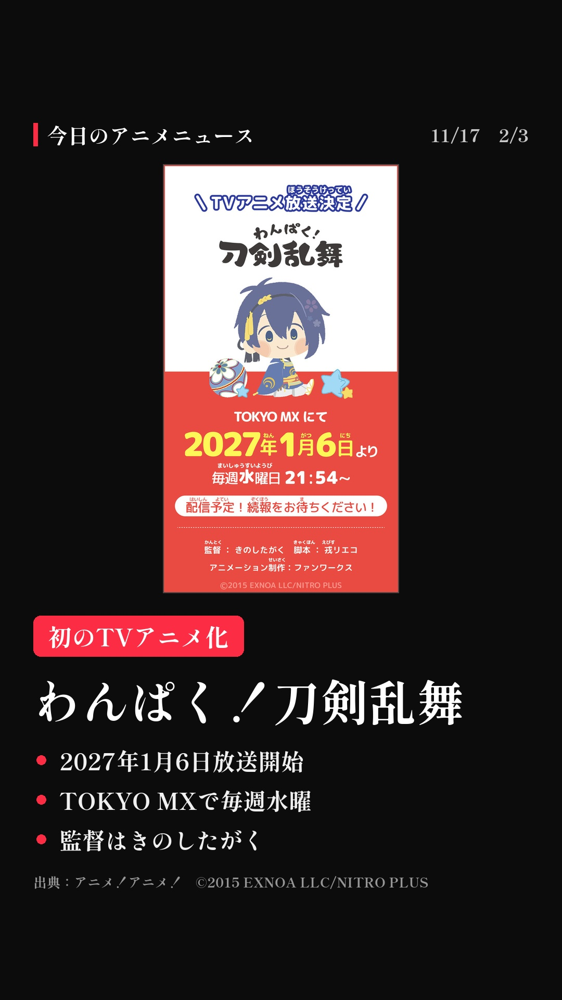
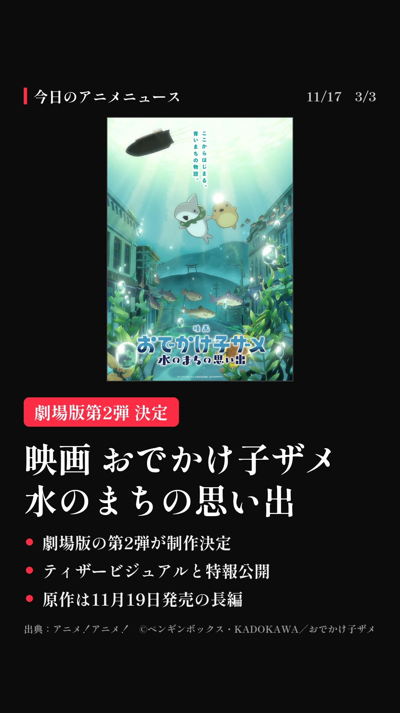

# 今日のアニメニュース

Threadsへの自動投稿: **していない（お試し中。ここで中身を見るだけ）**

## 2026-11-17

### ストーリー画像（長押しで保存）





<details><summary>Threadsの投稿 5本</summary>

**18:00 映画 おでかけ子ザメ水のまちの思い出**

```
【劇場版第2弾 決定】映画 おでかけ子ザメ水のまちの思い出

・劇場版の第2弾が制作決定
・ティザービジュアルと特報公開
・原作は11月19日発売の長編

ペンギンボックスさんの原作コミック「おでかけ子ザメ長編 子ザメとみずのまち」を原作とするストーリーとのことです。公開は来年と原作者がコメントしています。

出典：アニメ！アニメ！
```

**19:00 ダイヤモンドの功罪**

```
【TVアニメ化決定】ダイヤモンドの功罪

・制作はラパントラック
・監督は長友孝和
・原作は累計200万部突破

監督の長友孝和さんは「正反対な君と僕」の監督です。原作は「このマンガがすごい！2024 オトコ編」第1位。

アニメ化決定ビジュアルも公開されています。続報が楽しみですね。

出典：アニメ！アニメ！
```

**21:00 わんぱく！刀剣乱舞**

```
【初のTVアニメ化】わんぱく！刀剣乱舞

・2027年1月6日放送開始
・TOKYO MXで毎週水曜
・監督はきのしたがく

サンリオのデザインプロデュースによるショートアニメ。脚本は戎リエコ、アニメーション制作はファンワークス。公式Xでは12月5日まで毎日12時に1振りずつキャラクターを発表。

出典：アニメ！アニメ！
```

**22:00 風を継ぐもの**

```
【キービジュアル公開】風を継ぐもの

・2027年1月から日曜23時30分
・OP・EDはくるり＋羊文学
・U-NEXTほかで配信決定

主題歌のシングルCDは2027年3月17日発売。Blu-ray BOXとDVD BOXは2027年5月26日発売です。

出典：アニメ！アニメ！
```

**22:30 まとめ**

```
【11/17 のアニメニュースまとめ】

・ダイヤモンドの功罪：TVアニメ化決定
・わんぱく！刀剣乱舞：初のTVアニメ化
・映画 おでかけ子ザメ水のまちの思い出：劇場版第2弾 決定
・風を継ぐもの：キービジュアル公開

気になるニュースはありましたか？
```

</details>

